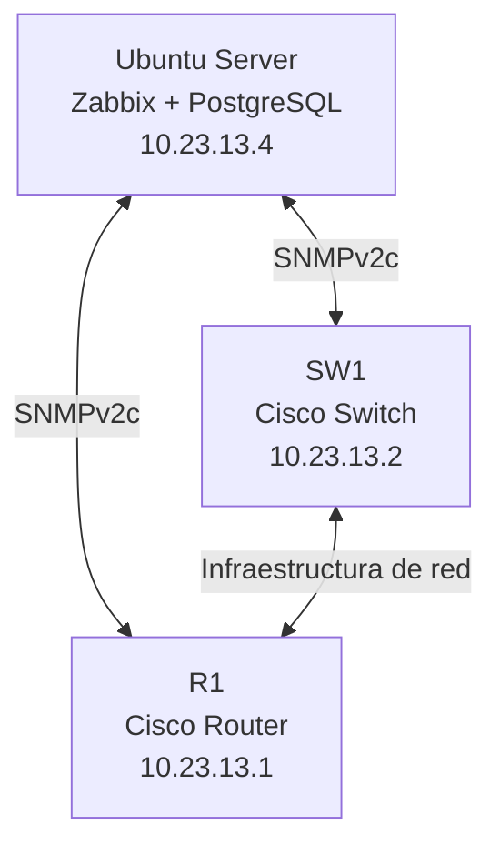

# Laboratorio de Monitoreo de Redes con Zabbix y SNMP

## 🎥 Video demostrativo

**Demostración completa del laboratorio:**

[VER VIDEO DEMOSTRATIVO](PEGAR_AQUI_EL_ENLACE_DEL_VIDEO)

---

## 1. Descripción del proyecto

Este laboratorio tiene como finalidad implementar una solución de monitoreo de infraestructura de red utilizando **Zabbix**, instalado sobre Ubuntu Server, integrando dispositivos de red Cisco mediante el protocolo SNMPv2c.

La implementación permite supervisar el estado y rendimiento de los dispositivos, recopilar información de sus interfaces, consultar métricas de CPU y memoria, y visualizar el comportamiento de la infraestructura desde una plataforma centralizada.

## 2. Objetivos del laboratorio

### Objetivo general

Implementar una plataforma centralizada de monitoreo de red mediante Zabbix y SNMP, permitiendo supervisar dispositivos Cisco y obtener información sobre su disponibilidad, rendimiento y estado operativo.

### Objetivos específicos

- Instalar y configurar Zabbix sobre Ubuntu Server.
- Configurar el protocolo SNMPv2c en dispositivos Cisco.
- Implementar listas de control de acceso (ACL) para restringir las consultas SNMP.
- Integrar un router y un switch Cisco a Zabbix.
- Implementar plantillas de monitoreo Cisco IOS by SNMP.
- Supervisar CPU, memoria, interfaces y tráfico de red.
- Verificar la disponibilidad de los dispositivos mediante ICMP.
- Visualizar métricas y generar evidencias del funcionamiento.

## 3. Tecnologías utilizadas

| Tecnología | Función |
|---|---|
| Ubuntu Server | Sistema operativo del servidor |
| Zabbix | Plataforma de monitoreo |
| PostgreSQL | Sistema gestor de base de datos |
| Apache | Servidor web |
| PHP | Entorno del frontend |
| SNMPv2c | Protocolo de monitoreo |
| Cisco IOS | Sistema operativo de los dispositivos de red |
| GNS3 | Simulación de infraestructura |

## 4. Topología de red

### Direccionamiento IP

| Dispositivo | Dirección IP | Función |
|---|---|---|
| R1 | 10.23.13.1 | Router Cisco |
| SW1 | 10.23.13.2 | Switch Cisco |
| SERVER-ZABBIX | 10.23.13.4 | Servidor de monitoreo |

### Diagrama de infraestructura



## 5. Configuración SNMP

Se implementó SNMPv2c para permitir que Zabbix consulte información de los dispositivos Cisco.

### Configuración de R1

```cisco
snmp-server contact Administrador TI
snmp-server location Laboratorio ITLA - R1
snmp-server community ZBX_MON_RO RO 90

access-list 90 permit host 10.23.13.4
```

### Configuración de SW1

```cisco
snmp-server community ZBX_MON_RO RO 90

access-list 90 permit host 10.23.13.4
```

**Seguridad:** Se utiliza una ACL estándar para permitir consultas SNMP únicamente desde el servidor de monitoreo `10.23.13.4`.

Nota: SNMPv2c transmite la comunidad sin cifrado. Para entornos productivos se recomienda SNMPv3.

## 6. Integración de dispositivos en Zabbix

Se registraron los dispositivos Cisco en la plataforma Zabbix.

### Configuración de los hosts

| Parámetro | R1 | SW1 |
|---|---|---|
| Host name | R1 | SW1 |
| Host group | Equipos de Red | Equipos de Red |
| Interfaz | SNMP | SNMP |
| Dirección IP | 10.23.13.1 | 10.23.13.2 |
| Puerto | 161 | 161 |
| Versión | SNMPv2 | SNMPv2 |
| Plantilla | Cisco IOS by SNMP | Cisco IOS by SNMP |

## 7. Monitoreo y métricas

La plantilla Cisco IOS by SNMP permite recopilar información de los dispositivos.

Las métricas supervisadas incluyen:

- Disponibilidad mediante ICMP.
- Utilización de CPU.
- Memoria utilizada y disponible.
- Estado de las interfaces.
- Tráfico entrante y saliente.
- Paquetes transmitidos y recibidos.
- Temperatura del hardware, cuando está disponible.
- Estado de fuentes de alimentación, cuando está disponible.

## 8. Resultados obtenidos

Durante las pruebas de integración de R1 se obtuvieron los siguientes resultados:

| Métrica | Resultado |
|---|---:|
| CPU | 0 % |
| Memoria utilizada | 11.37 MB |
| Memoria libre | 20.63 MB |
| Utilización de memoria | 35.52 % |
| Temperatura | 22 °C |
| Disponibilidad ICMP | UP |
| Pérdida de paquetes | 0 % |
| Respuesta ICMP | 12.23 ms |
| Interfaz Gi0/0 | Full Duplex |

Se verificó la comunicación SNMP mediante consultas SNMP Walk desde Ubuntu Server, obteniendo información de ambos dispositivos Cisco.

## 9. Evidencias del laboratorio

Las siguientes evidencias deben incorporarse al repositorio:

### 9.1 Topología de red


### 9.2 Servidor Zabbix


### 9.3 Dispositivos registrados


### 9.4 Monitoreo de R1


### 9.5 Monitoreo de SW1


- Conectividad IP.
- Respuesta ICMP.
- Disponibilidad SNMP.
- Consultas SNMP Walk.

## Running-Configs
[Configuraciones de los dispositivos](running-config)

---

**Proyecto académico – ITLA**

**Categoría:** Administración y monitoreo de redes.

**Herramientas principales:** Zabbix, Ubuntu Server, SNMPv2c y Cisco IOS.
